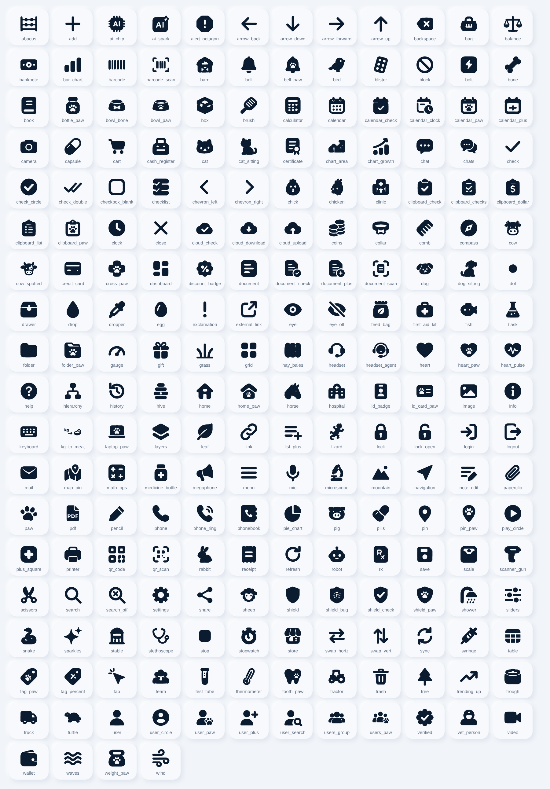

# Iconos propios de VetDosis

La app deja de usar los iconos de Material en sus pantallas y usa un juego
propio, sólido y de esquinas redondas, hecho a partir de las cuatro láminas que
entregó Ale el 11 de noviembre de 2026.



## Qué hay

220 iconos en una sola fuente, `assets/fonts/VetIcons.ttf` (unos 100 KB):

- **144 vienen de las láminas.** Las cuatro suman 215 dibujos, pero muchos se
  repiten entre ellas (huella, perro, gato, jeringa…). De cada repetido se
  conservó el de la lámina con más resolución.
- **76 se dibujaron aparte** porque la app los usaba y no venían: flechas,
  buscar, agregar, palomita, candado, ojo, micrófono, guardar, compartir,
  papelera, lápiz, huevo, colmena, matraz, balanza, PDF, escáner de QR y de
  documento, entre otros. Están hechos con trazo grueso y puntas redondas para
  que no desentonen.

Se usan igual que los de Material:

```dart
import 'package:vetdosis_pro/vet_ui.dart';

const Icon(VetIcons.paw)
VetActionButton(icon: VetIcons.syringe, ...)
```

Toman color y tamaño del tema, como cualquier `Icon`.

## Qué cambió en la app

Los 173 iconos distintos de Material que aparecían en `lib/` se sustituyeron por su
equivalente. Donde Material obligaba a una metáfora, ahora hay un dibujo de la
especie:

| Dónde | Antes (Material) | Ahora |
|---|---|---|
| Producción · Bovinos | pasto | vaca |
| Producción · Ovinos / caprinos | paisaje | oveja |
| Producción · Aves | huevo | gallina |
| Producción · Porcinos | alcancía | cerdo |
| Producción · Equinos | persona corriendo | caballo |
| Producción · Peces | platillo | pez |
| Constantes · equino, bovino, porcino | tractor (los tres) | caballo, vaca, cerdo |
| Constantes · reptil | montaña | lagartija |
| Calculadora de hato | huella | vaca |
| Calculadora de alimento | pasto | costal de alimento |
| Exóticos / Silvestres | árbol | conejo, igual que el selector de práctica |

## Límites, para no dar por hecho lo que no es

- **Un solo estilo.** Material distinguía relleno y contorno (`home` y
  `home_outlined`). Aquí ambos apuntan al mismo dibujo; el estado seleccionado
  se sigue marcando con color e indicador, no con el icono.
- **Quedan iconos de Material** en lo que dibuja Flutter por dentro: la flecha
  de los desplegables, el menú de hamburguesa, el selector de fechas, las
  casillas. Por eso `uses-material-design` sigue activo.
- **Las láminas son imágenes, no vectores.** Los iconos se calcaron
  automáticamente; a 24 px se ven limpios, pero ampliados se nota el borde algo
  blando en los que venían de la lámina más pequeña (reptiles, granja).
  Si se consiguen los originales en vector, basta reemplazar el SVG.
- **78 dibujos de las láminas no se usan todavía** en ninguna pantalla (peine,
  collar, regalo, robot, ábaco…). Están en la fuente, listos; al compilar con
  `--tree-shake-icons` los que no se usen no viajan en el APK.
- **No probado en teléfono.** Se verificó con análisis estático, la suite de
  pruebas y capturas de `test/previews/`; falta verlo en un dispositivo real.

## Agregar o cambiar un icono

Todo vive en `tools/icons/`:

| Ruta | Qué es |
|---|---|
| `sheets/*.png` + `sheets/names.json` | Las láminas originales y el nombre de cada dibujo |
| `authored/*.svg` | Los iconos dibujados a mano (trazos, no calco) |
| `svg/*.svg` | Resultado: un trazo por icono, lienzo 24×24. **De aquí sale la fuente** |
| `codepoints.json` | Código de cada icono. Estable: uno nuevo toma el siguiente libre |
| `sources.json` | De qué lámina (o de `authored`) salió cada uno |

Para uno nuevo: dibujarlo en `authored/nombre.svg` con negro sobre blanco (el
blanco recorta), y correr:

```bash
pip install pillow numpy potracer fonttools
python3 tools/icons/trace.py        # láminas y authored/ -> svg/
python3 tools/icons/build_font.py   # svg/ -> VetIcons.ttf y vet_icons.dart
node tools/icons/catalog.js         # vuelve a pintar el catálogo de arriba
```

`trace.py` necesita además Node con Playwright para rasterizar `authored/`.
`lib/vet_ui/vet_icons.dart` es generado: no se edita a mano.
`test/vet_icons_test.dart` falla si la clase, `codepoints.json` y `svg/` dejan
de coincidir.
